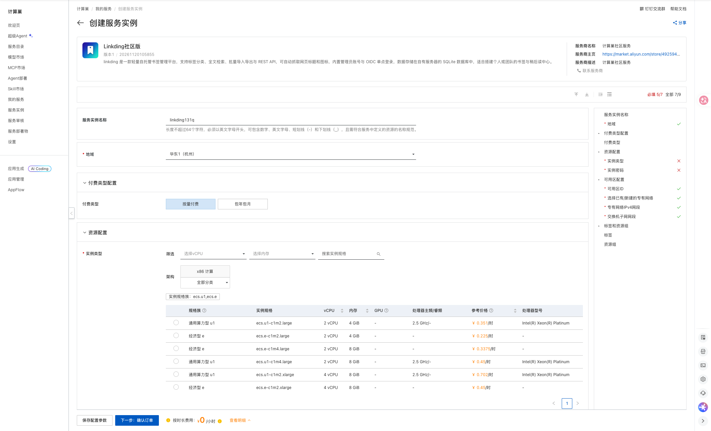
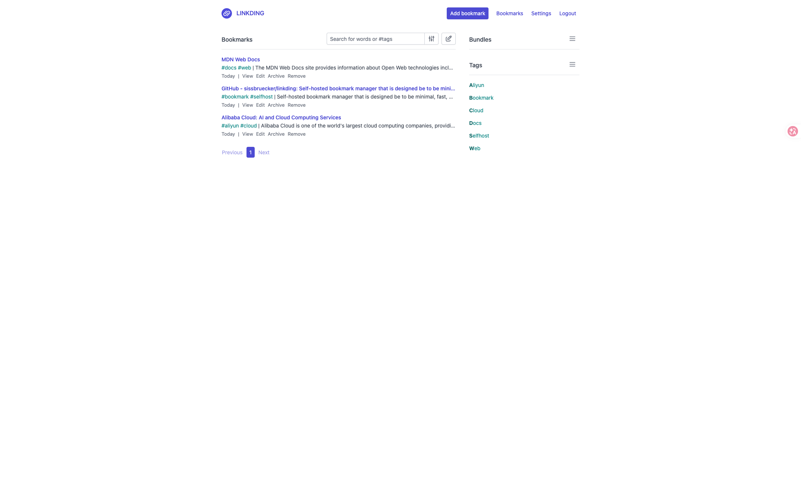

# Deploying Linkding on Alibaba Cloud Compute Nest

## About the service

Linkding is an MIT-licensed, self-hosted bookmark manager. It moves your browser bookmarks onto your own server, where tags, keyword search and faceted filters stay fast even with hundreds of thousands of bookmarks. It imports browser bookmark exports, ships a REST API and browser extensions, and keeps everything in a local SQLite database without relying on any third-party online service.

This Compute Nest service deploys a single ECS instance. The image already contains Linkding and its Docker Compose runtime, and all data stays on the instance.

Linkding is served on port 9090 of the instance public IP. Opening the address redirects to the bookmark list and requires sign-in. The username is always `admin`; the initial password is listed in the service instance outputs.

## Billing

Creating a service from this template is free. Running a service instance incurs:

- ECS instance (minimum 2 vCPU, 4 GiB memory)
- System disk (fixed at 200 GiB ESSD by the template)
- Public bandwidth (fixed at 5 Mbps by the template)

Both pay-as-you-go and subscription are supported; the estimate is shown before you confirm the order.

## Required RAM permissions

If you create the instance with a RAM user, grant the following policies first.

| Policy | Purpose |
| --- | --- |
| AliyunECSFullAccess | Manage ECS instances |
| AliyunVPCFullAccess | Manage VPC resources |
| AliyunROSFullAccess | Manage Resource Orchestration Service stacks |
| AliyunComputeNestUserFullAccess | Manage Compute Nest user-side resources |

## Deployment steps

1. Open the instance creation page, choose a region, and specify the instance type and instance password. You can create a new VPC or use an existing VPC and vSwitch.

   [Deploy now](https://computenest.console.aliyun.com/service/instance/create/cn-hangzhou?type=user&ServiceId=service-a4f92262ea104a239fe6)

   

2. Review the price estimate, choose **Next: Confirm Order**, accept the service agreement and click **Create Now**.

3. Wait for the deployment to finish. The **Outputs** section of the instance details page lists `linkding_9090_url` and the admin password.

4. Open the URL from the outputs (`http://<public-ip>:9090`), sign in as `admin` with the generated password, and use **Add bookmark** to save your first link.

   

## First steps

### Add your first bookmark

Paste a URL into the input at the top of the bookmark list and save. You can add a title, description and tags on the details page. Tags support `+` combinations and exclusions for faceted filtering.

### Import browser bookmarks

Use **Import** on the settings page with the HTML file your browser exported, or run `manage.py` on the instance for bulk operations. Everything stays on the instance.

### Data persistence

Bookmarks and accounts live under `/opt/linkding/data` on the system disk (`db.sqlite3`, assets, favicons, previews and `secretkey.txt`). `docker compose down` and instance restarts keep the data; releasing the instance deletes it, so back up that directory regularly.

### Change the admin password

The initial password only applies when the account is first created; editing the password in `.env` later does not change an existing account. Open Settings → Change password in the UI, or run `cd /opt/linkding && docker compose exec linkding python manage.py changepassword admin` on the instance.

### Change runtime settings

Edit `/opt/linkding/.env` on the instance and run `cd /opt/linkding && docker compose up -d`. Values in `.env` are injected into the container as environment variables.

## Parameters

| Parameter | Description | Default |
| --- | --- | --- |
| VpcOption | Create a new VPC or reuse an existing one | NewVPC |
| VpcCidrBlock | CIDR block of the new VPC | 192.168.0.0/16 |
| VSwitchCidrBlock | CIDR block of the new vSwitch | 192.168.1.0/24 |
| EcsInstanceType | ECS instance type, at least 2 vCPU / 4 GiB | none |
| InstancePassword | Password for the ECS instance | none |
| PayType | Billing method | PostPaid |
| ZoneId | Availability zone | none |
| VpcId / VSwitchId | Existing VPC and vSwitch (when reusing a VPC) | empty |

## Outputs

| Output | Description |
| --- | --- |
| linkding_9090_url | Linkding URL (port 9090) |
| AdminUsername | Admin username (`admin`) |
| AdminPassword | Generated admin password |
| DataPersistenceNote | Data directory and backup notes |
| MetadataFetchNote | Notes on page title and icon fetching |
| SnapshotNote | Notes on web snapshot support |

## Security notes

- Fetching page titles, icons and previews requires outbound internet access. Failures for overseas sites only affect presentation, not saving. Set `LD_DISABLE_BACKGROUND_TASKS=True` to turn background tasks off.
- Internal addresses are blocked by SSRF protection by default; allow specific hosts with `LD_ALLOWED_INTERNAL_HOSTS` if you need internal bookmarks.
- The delivered image does not generate server-side web snapshots. Install the SingleFile browser extension and upload snapshots to `/api/bookmarks/singlefile/`; generate a REST API token on the settings page.
- All data lives under `/opt/linkding/data` on the system disk and is deleted with the instance.

## Troubleshooting

**Sign-in says the username or password is wrong.** The username is `admin` and the password is the `AdminPassword` output value (or the password you changed it to).

**Bookmarks have no title or icon.** Titles and icons are fetched by background tasks and need outbound access. Failures do not affect the bookmark itself; edit it manually to fill them in.

**Expose the API to another system.** Generate a REST API token on the settings page and call `/api/bookmarks/` with `Authorization: Token <token>`.

## Links

- Source code: https://github.com/sissbruecker/linkding
- Documentation: https://linkding.link/
- License: MIT
