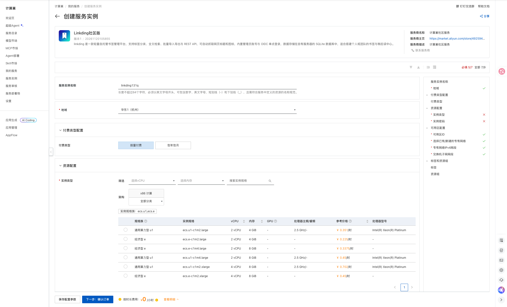

# Linkding 计算巢部署文档

## 服务说明

Linkding 是一款 MIT 许可开源自托管的书签管理器：把浏览器收藏夹搬到自己的服务器上，用标签、关键词和分面组合检索，几十万条书签也不会卡；支持导入浏览器导出的收藏夹文件、提供 REST API 与浏览器扩展，书签数据保存在实例本机的 SQLite 数据库里，不依赖任何第三方在线服务。

本计算巢服务采用单机 ECS 部署，ECS 镜像内已预置 Linkding 与 Docker Compose 运行环境，数据全部保存在实例本机。

访问入口为实例公网 IP 的 9090 端口。打开地址会跳转到书签页并要求登录，用户名固定为 `admin`，初始密码在服务实例输出中查看。

## 计费说明

通过此服务模板构建服务不产生费用。用户部署服务实例时，资源费用主要涉及：

- ECS 实例规格（最低 2 vCPU、4 GiB 内存）
- 系统盘容量（模板固定 200 GiB ESSD）
- 公网带宽（模板固定 5 Mbps）

计费方式支持按量付费和包年包月，预估费用会在部署前实时展示。

## RAM账号所需权限

若使用 RAM 用户创建服务实例，需要在创建服务实例前为该 RAM 用户添加相应权限。

| 权限策略名称 | 备注 |
| --- | --- |
| AliyunECSFullAccess | 管理云服务器 ECS 的权限 |
| AliyunVPCFullAccess | 管理专有网络 VPC 的权限 |
| AliyunROSFullAccess | 管理资源编排 ROS 的权限 |
| AliyunComputeNestUserFullAccess | 管理计算巢服务用户侧资源的权限 |

## 服务实例部署流程

### 部署步骤

1. 打开计算巢服务实例创建页面，选择部署地域，填写实例规格、实例密码。网络可选择新建 VPC，也可以选择已有的 VPC 与交换机。

   [部署链接](https://computenest.console.aliyun.com/service/instance/create/cn-hangzhou?type=user&ServiceId=service-a4f92262ea104a239fe6)

   

2. 确认询价明细后点击 **下一步：确认订单**，同意服务协议并点击 **立即创建**。

3. 等待服务实例部署完成。部署完成后，在服务实例详情页的 **输出** 区域查看 `linkding_9090_url` 访问地址与管理员密码。

4. 用浏览器打开输出中的访问地址（`http://<实例公网IP>:9090`），使用用户名 `admin` 与输出中的管理员密码登录，通过 **Add bookmark** 保存第一条书签。

   

## 首次使用说明

### 1. 添加第一条书签

登录后在书签列表顶部的 URL 输入框粘贴地址并保存即可；也可以在详情页补充标题、描述与标签。标签支持 `+` 组合与排除语法，用于在列表里做分面检索。

### 2. 导入浏览器收藏夹

在设置页使用「Import」导入浏览器导出的书签 HTML 文件，也可以在实例内使用 `manage.py` 批量操作。导入过程只在本机执行，不会把书签发送到外部服务。

### 3. 数据持久化

书签与账号数据保存在实例系统盘的 `/opt/linkding/data` 目录（SQLite 数据库 `db.sqlite3`、assets、favicons、previews 与 `secretkey.txt`），执行 `docker compose down` 或重启实例不会丢数据；释放实例即全部丢失，请定期备份该目录。

### 4. 修改管理员密码

初始密码只在首次启动创建账号时生效，之后修改 `.env` 里的密码不会改变已有账号。如需改密，登录后进入 Settings 页点击 Change password，或登录实例执行 `cd /opt/linkding && docker compose exec linkding python manage.py changepassword admin`。

### 5. 修改运行参数

登录实例编辑 `/opt/linkding/.env`，然后执行 `cd /opt/linkding && docker compose up -d` 生效；`.env` 中的键值会以环境变量方式注入容器。

## 参数说明

| 参数 | 说明 | 默认值 |
| --- | --- | --- |
| VpcOption | 网络类型，新建 VPC 或使用已有 VPC | NewVPC |
| VpcCidrBlock | 新建 VPC 的网段 | 192.168.0.0/16 |
| VSwitchCidrBlock | 新建交换机的网段 | 192.168.1.0/24 |
| EcsInstanceType | ECS 实例规格，最低 2 vCPU 4 GiB | 无 |
| InstancePassword | 实例登录密码 | 无 |
| PayType | 付费类型 | PostPaid |
| ZoneId | 可用区 | 无 |
| VpcId / VSwitchId | 已有 VPC 与交换机 ID（选择已有 VPC 时填写） | 空 |

## 输出说明

| 输出 | 说明 |
| --- | --- |
| linkding_9090_url | Linkding 访问地址（端口 9090） |
| AdminUsername | 管理员用户名（admin） |
| AdminPassword | 系统随机生成的管理员密码 |
| DataPersistenceNote | 数据目录与备份说明 |
| MetadataFetchNote | 网页标题与图标抓取说明 |
| SnapshotNote | 网页快照能力说明 |

## 安全与使用说明

- 抓取网页标题、图标与预览图需要实例具备公网出口；抓取境外站点失败只影响展示效果，不影响书签保存。如不需要，可设置 `LD_DISABLE_BACKGROUND_TASKS=True` 关闭后台任务。
- 内网地址默认被 SSRF 防护拦截；如需保存内网书签，通过 `LD_ALLOWED_INTERNAL_HOSTS` 放行对应主机。
- 当前交付的是基础镜像，不包含服务端自动生成网页快照的能力；如需保存网页存档，可在浏览器安装 SingleFile 扩展，把快照上传到 `/api/bookmarks/singlefile/` 接口，REST API 令牌可在登录后的 Settings 页生成。
- 所有数据保存在系统盘 `/opt/linkding/data`，释放服务实例会一并删除，请提前备份。

## 常见问题

**登录提示用户名或密码错误？**
用户名固定为 `admin`，密码在服务实例输出的 `AdminPassword` 中；如果改过密码，请使用修改后的密码。

**书签保存后没有标题和图标？**
标题与图标由后台任务抓取，需要实例能访问外网；抓取失败不影响书签本身，可以稍后手动编辑补充。

**需要给其他系统开放 API？**
在 Settings 页生成 REST API 令牌，调用方以 `Authorization: Token <令牌>` 访问 `/api/bookmarks/` 等接口。

## 官方链接

- 官方仓库：https://github.com/sissbruecker/linkding
- 官方文档：https://linkding.link/
- 许可证：MIT
